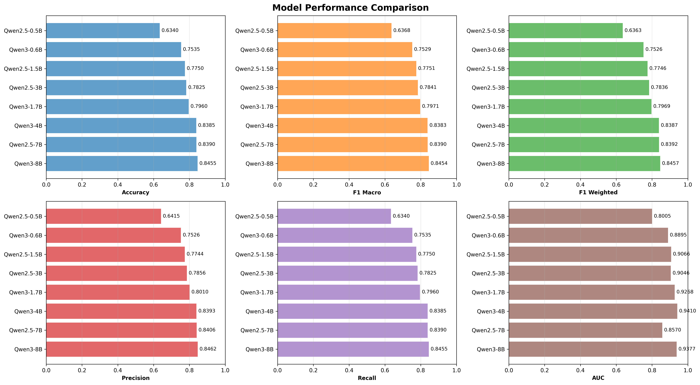
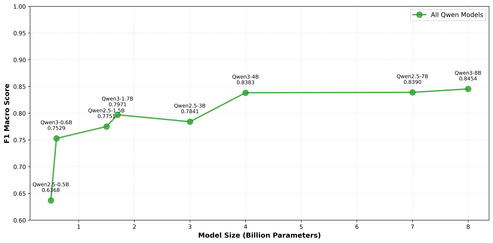

<!-- # Divide and Conquer: A Mixture-of-LoRA-Experts Approach for Efficient Hallucination Detection in Vietnamese LLMs -->

# Counterfactual Explanations for Vietnamese Hallucination Detection: Minimal Faithfulness Repairs with Security-Aware Robustness

## 📋 Overview

This repository contains the implementation and evaluation of hallucination detection models for Vietnamese Large Language Models (LLMs). The project focuses on identifying three types of hallucinations: **no hallucination**, **intrinsic hallucination**, and **extrinsic hallucination** in Vietnamese text generation.

The work is organised into three modules:

| Module | Description |
|--------|-------------|
| **A — Hallucination Detector** | Fine-tune 8 Qwen models (0.5B–8B, two families: Qwen2.5 & Qwen3) with LoRA on the UIT-ViHallu training set and benchmark on the 2 000-sample test set. Best result: **Qwen3-8B @ 84.55% accuracy / 0.8454 Macro-F1**. |
| **B — Counterfactual Dataset Construction & Validation** | Automatically generate 2 690 counterfactual (CF) pairs across four edit buckets (A: intra-sentence fix, B: sentence deletion, C: sentence append, D: word replacement). Validate each pair for label-flip correctness, minimality, and safety. **1 969 valid pairs (73.2% pass rate)**. |
| **C — Counterfactual Evaluation** | Evaluate three detectors (Qwen3-1.7B / 4B / 8B) on the valid CF set with metrics including CFR, DCS, MESR@k, Stability Score, Sensitivity Gap, and no-context ablations. Key insight: **standard accuracy scales with size but CFR does not** — larger models are less sensitive to minimal semantic perturbations. |

## 🎯 Problem Statement

Hallucinations in LLMs pose significant challenges for real-world applications. This work addresses:
- **Intrinsic Hallucination**: Outputs that contradict the provided context
- **Extrinsic Hallucination**: Outputs that cannot be verified from the given context
- **No Hallucination**: Factually correct and contextually grounded outputs

Beyond standard detection accuracy, we investigate **robustness**: does a detector truly understand *why* a response is hallucinated, or does it rely on surface cues? We answer this by constructing minimal counterfactual edits that flip the ground-truth label with as few token changes as possible, then measuring whether the detector's prediction follows suit. This counterfactual evaluation reveals a critical gap — high test-set accuracy alone does not guarantee causally grounded detection.

## 📊 Dataset

We use the **UIT-ViHallu** dataset for training and evaluation:
- **Training set**: Used for fine-tuning models
- **Validation set**: Used for hyperparameter tuning
- **Test set**: 2,000 samples for final evaluation
- **Classes**: 3 categories (no, intrinsic, extrinsic)

## Module A — Hallucination Detector
| Models | Accuracy | F1 Macro | F1 Weighted | Precision | Recall | AUC |
|--------|----------|----------|-------------|-----------|--------|-----|
| Qwen3-8B | 0.8455 | 0.8454 | 0.8457 | 0.8462 | 0.8455 | 0.9377 |
| Qwen2.5-7B | 0.8390 | 0.8390 | 0.8392 | 0.8406 | 0.8390 | 0.8570 |
| Qwen3-4B | 0.8385 | 0.8383 | 0.8387 | 0.8393 | 0.8385 | 0.9410 |
| Qwen3-1.7B | 0.7960 | 0.7971 | 0.7969 | 0.8010 | 0.7960 | 0.9268 |
| Qwen2.5-3B | 0.7825 | 0.7841 | 0.7836 | 0.7856 | 0.7825 | 0.9046 |
| Qwen2.5-1.5B | 0.7750 | 0.7751 | 0.7746 | 0.7744 | 0.7750 | 0.9066 |
| Qwen3-0.6B | 0.7535 | 0.7529 | 0.7526 | 0.7526 | 0.7535 | 0.8895 |
| Qwen2.5-0.5B | 0.6340 | 0.6368 | 0.6363 | 0.6415 | 0.6340 | 0.8005 |

### 📈 Model Performance Analysis

**Figure 1: Comprehensive Model Comparison**

*Comparison of all evaluation metrics (Accuracy, F1 Macro, F1 Weighted, Precision, Recall, AUC) across different model sizes. Larger models consistently achieve better performance across all metrics.*

**Figure 2: Overall Performance Trend**

*F1 Macro score progression across all Qwen models as model size increases. Shows a clear positive correlation between model parameters and detection accuracy, with diminishing returns beyond 4B parameters.*

**Figure 3: Family Comparison**

*Comparison between Qwen2.5 and Qwen3 model families. Qwen3 models generally outperform their Qwen2.5 counterparts at similar parameter counts, suggesting architectural improvements in the newer generation.*

### 🔍 Key Findings

- **Best Performance**: Qwen3-8B achieves the highest accuracy of **84.55%** with F1 Macro of **0.8454**
- **Efficiency-Performance Trade-off**: Qwen3-4B offers excellent performance (83.85% accuracy) with significantly fewer parameters
- **Scaling Benefits**: Clear performance improvements with model size, especially from 0.5B to 4B parameters
- **Architecture Matters**: Qwen3 models consistently outperform Qwen2.5 at comparable sizes

## Module B — Counterfactual Dataset Validation

### Overview

| Metric | Value |
|--------|-------|
| Total CF pairs generated | 2690 |
| Valid pairs | 1969 |
| Valid rate | 73.20%  |

### Bucket Distribution

| Bucket | Total | Valid | Coverage |
|--------|-------|-------|----------|
| A | 672 | 512 | 76.19% |
| B | 638 | 404 | 63.32% |
| C | 690 | 590 | 85.51% |
| D | 690 | 463 | 67.10% |

> Bucket A = intra-sentence factual fix; B = sentence deletion; C = sentence append; D = word-level replacement.

### Top Invalid Reasons (aggregated)

| # | Reason | Count |
|---|--------|-------|
| 1 | `bucket_B_sentence_change_not_minus1(0)` | 204 |
| 2 | `D_target_not_in_response` | 96 |
| 3 | `bucket_D_no_contradiction` | 84 |
| 4 | `no_change` | 43 |
| 5 | `D_replacement_same_as_target` | 18 |
| 6 | `minimality_fail_tok(tok=17)` | 14 |
| 7 | `minimality_fail_tok(tok=27)` | 13 |
| 8 | `bucket_B_not_deletion` | 12 |
| 9 | `minimality_fail_tok(tok=18)` | 12 |
| 10 | `D_replacement_too_long(6)` | 12 |

### Edit-Size Statistics (valid pairs only)

| Stat | Value |
|------|-------|
| Count | 1969 |
| Min | 1 |
| Median | 8 |
| Mean | 9.13 |
| P90 | 21 |
| Max | 51 |

**Edit-size bin counts:**

| Bin | Count | % of valid |
|-----|-------|------------|
| ≤1 | 462 | 23.5% |
| ≤3 | 639 | 32.5% |
| ≤5 | 780 | 39.6% |
| ≤10 | 1320 | 67.0% |
| >10 | 649 | 33.0% |

### Sentence-Change Distribution (valid pairs)

| sentence_change | Count | % |
|-----------------|-------|---|
| -1 | 208 | 10.6% |
| 0 | 1171 | 59.5% |
| 1 | 590 | 30.0% |

### Limitations & Action Items

- **Bucket B has lowest coverage (63.3%)**: primary failure is `bucket_B_sentence_change_not_minus1` — the generator often fails to produce a proper sentence-deletion CF.
- **Bucket D**: `D_target_not_in_response` (96) and `bucket_D_no_contradiction` (84) dominate invalid cases — the small entity replacement sometimes cannot find the target span.
- **Minimality failures** in Buckets A and C can be reduced by tightening the token-edit budget or adding a post-hoc minimality filter.
- Consider re-running failed Bucket-B samples with a specialized deletion prompt.

## Module C — Counterfactual Evaluation Insights

### C1 — Setup Recap

- **Test set size**: 2,000 samples (3 classes: no / intrinsic / extrinsic)
- **Counterfactual valid pairs**: 1969 / 2690 (73.20% coverage)
- **Bucket distribution (valid)**: A=512, B=404, C=590, D=463
- **Metrics**: Accuracy, Macro-F1 (standard); CFR (counterfactual flip rate = fraction of valid CFs where model correctly flips prediction), DCS (decision change score), MESR@k (minimal-edit success rate on subsets with edit_size ≤ k), Stability Score = 1 − flip_rate_nonsemantic, Sensitivity Gap = CFR − flip_rate_nonsemantic.

### C2 — Key Findings

- **Standard accuracy scales with model size**: Qwen3-1.7B 0.7960 → Qwen3-4B 0.8385 → Qwen3-8B 0.8455.
- **CFR does NOT scale with model size**: Qwen3-1.7B CFR=0.5338 ≈ Qwen3-4B CFR=0.5312 > Qwen3-8B CFR=0.3647. The largest model is *less* sensitive to minimal semantic edits.
- **Bucket B (sentence deletion) is the hardest**: CFR_B ranges from 0.1040 to 0.1510, far below the overall CFR. Deletion removes stylistic cues models rely on.
- **Bucket C (sentence append) is easiest for smaller models**: CFR_C = 0.9068 (1.7B), 0.8898 (4B), but drops to 0.2441 (8B) — the 8B model resists appended sentences.
- **Bucket D (word replacement) shows inverse scaling for 8B**: CFR_D = 0.8164 (8B) > 0.5788 (1.7B), suggesting the largest model is more sensitive to entity-level swaps.
- **Stability decreases with scale**: SS = 0.7250 (1.7B) → 0.8100 (4B) → 0.6250 (8B). Larger models are more volatile on non-semantic perturbations.
- **Sensitivity Gap (SG = CFR − flip_rate)**: Qwen3-1.7B SG=0.2588 (good), Qwen3-4B SG=0.3412, Qwen3-8B SG=-0.0103 (≈0, meaning semantic and noise flips are equally likely).
- **No-context accuracy and CFR**: without context, accuracy drops to 0.5655–0.5850. No-context CFR for 1.7B (0.4525) < with-context CFR (0.5338), confirming models use context to detect hallucinations.
- **Confidence drops on CFs**: mean ΔConf = -0.2749 (1.7B), -0.3288 (4B), -0.4417 (8B). Larger models show steeper confidence drops, indicating they detect semantic changes but still predict the wrong label.

### C3 — Evaluation Tables

#### Table 1 — Standard Performance

| Model | Accuracy | Macro-F1 | Weighted-F1 |
|-------|----------|----------|-------------|
| Qwen3-1.7B | 0.7960 | 0.7971 | 0.7969 |
| Qwen3-4B | 0.8385 | 0.8383 | 0.8387 |
| Qwen3-8B | 0.8455 | 0.8454 | 0.8457 |

> *Reading guide*: Standard 3-class hallucination detection on the 2 000-sample test set. Higher is better.

#### Table 2 — Counterfactual Overall

| Model | CFR | DCS | n_valid | coverage | ΔConf_mean | ΔConf_median |
|-------|-----|-----|---------|----------|------------|------------|
| Qwen3-1.7B | 0.5338 | 0.7942 | 1969 | 73.20% | -0.2749 | -0.2583 |
| Qwen3-4B | 0.5312 | 0.7548 | 1969 | 73.20% | -0.3288 | -0.3048 |
| Qwen3-8B | 0.3647 | 0.4795 | 1969 | 73.20% | -0.4417 | -0.5163 |

> *Reading guide*: CFR = fraction of valid CFs where the model correctly flips its prediction to the expected label. DCS = fraction where the model changes its decision at all (even if to a wrong class). ΔConf = change in predicted-class confidence (negative = model becomes less confident).

#### Table 3 — Counterfactual Bucket-wise CFR

| Model | A_CFR | B_CFR | C_CFR | D_CFR |
|-------|-------|-------|-------|-------|
| Qwen3-1.7B | 0.3652 | 0.1510 | 0.9068 | 0.5788 |
| Qwen3-4B | 0.4062 | 0.1188 | 0.8898 | 0.5724 |
| Qwen3-8B | 0.3008 | 0.1040 | 0.2441 | 0.8164 |
| *n_valid* | 512 | 404 | 590 | 463 |

> *Reading guide*: A = intra-sentence factual fix, B = sentence deletion, C = sentence append, D = word-level entity replacement. Bucket B is consistently the hardest across all models.

#### Table 4 — Robustness (Stability + No-Context)

| Model | StabilityScore | FlipRate_nonsem | SG | NoCtxAcc | NoCtxCFR |
|-------|----------------|-----------------|-----|----------|----------|
| Qwen3-1.7B | 0.7250 | 0.2750 | 0.2588 | 0.5655 | 0.4525 |
| Qwen3-4B | 0.8100 | 0.1900 | 0.3412 | 0.5035 | 0.3885 |
| Qwen3-8B | 0.6250 | 0.3750 | -0.0103 | 0.5850 | 0.3479 |

> *Reading guide*: SS = 1 − flip_rate on non-semantic perturbations (higher = more stable). SG = CFR − flip_rate (positive = model is more sensitive to *semantic* changes than to noise, which is desirable). NoCtxAcc/NoCtxCFR = performance when context is removed — measures reliance on superficial cues.

#### Table 5 — MESR@k & Subset Counts

| Model | n≤1 | MESR@1 | n≤3 | MESR@3 | n≤5 | MESR@5 | n≤10 | MESR@10 |
|-------|-----|--------|-----|--------|-----|--------|------|--------|
| Qwen3-1.7B | 462 | 0.5281 | 639 | 0.4710 | 780 | 0.4846 | 1320 | 0.5856 |
| Qwen3-4B | 462 | 0.5281 | 639 | 0.4710 | 780 | 0.4872 | 1320 | 0.5750 |
| Qwen3-8B | 462 | 0.7273 | 639 | 0.6291 | 780 | 0.5577 | 1320 | 0.4068 |

> *Reading guide*: MESR@k = counterfactual flip rate computed only on the subset of pairs with `edit_size ≤ k`. Because each threshold defines a *different* subset, MESR@k may decrease as k increases (the added samples are harder, not easier). n≤k = subset size.

### C4 — Interpretation & Next Steps

**Why is Bucket B so difficult?** Bucket B counterfactuals delete an entire sentence that originally introduced an extrinsic hallucination. When an extrinsic sentence is removed, the remaining response becomes *shorter* and merely faithful — but models trained on length and stylistic cues often still predict "extrinsic" because the prompt style or remaining content pattern hasn't changed. The consistently low CFR_B (0.10–0.15) across all scales confirms that current detectors depend heavily on surface signals beyond the actual semantic content.

**Model-scale trade-off: standard ↑ but CFR ↓.** While standard accuracy rises from 0.7960 (1.7B) to 0.8455 (8B), overall CFR *decreases* from 0.5338 to 0.3647. The larger model is better at memorizing training-distribution patterns but worse at adapting to minimal semantic perturbations. This reveals an important gap: high test-set accuracy alone does not guarantee robust, causally grounded detection.

**Stability vs. sensitivity.** Qwen3-8B's flip_rate_nonsemantic is 0.375 (vs. 0.275 for 1.7B), meaning it flips predictions on 37.5% of *non-semantic* perturbations. Its near-zero Sensitivity Gap (SG ≈ −0.01) indicates it cannot distinguish between meaningful semantic edits and surface noise. A robust detector should have high CFR and low flip_rate — i.e., high SG.

**Proposed next steps:** (1) Analyse confusion matrices per bucket to locate which class transitions the model struggles with (e.g., intrinsic→no vs. extrinsic→no). (2) Bin CFR by edit_size (≤3, 4–10, >10) to quantify whether minimal edits are harder or easier to detect. (3) Augment training with counterfactual pairs to improve causal sensitivity. (4) Investigate adversarial training or consistency regularisation to reduce non-semantic flip rate while preserving CFR.

## 🚀 Quick Start

### Installation

```bash
# Clone the repository
git clone https://github.com/yourusername/UIT-ViHallu.git
cd UIT-ViHallu

# Install dependencies
pip install -r requirements.txt
```

### Training

```bash
# Train a hallucination detection model
python scripts/qwen.py
```

## 📁 Project Structure

```
UIT-ViHallu/
├── data/                      # Dataset files
│   ├── vihallu_train.csv
│   ├── vihallu_dev.csv
│   └── vihallu_test.csv
├── models/                    # Trained models and predictions
│   ├── Qwen_Qwen2.5_0.5B/
│   ├── Qwen_Qwen3_8B/
│   └── ...
├── scripts/                   # Training and evaluation scripts
│   ├── qwen.py
│   └── load_and_inference.py
├── notebooks/                 # Jupyter notebooks for analysis
│   └── evaluate_models.ipynb
├── results/                   # Evaluation results and figures
│   ├── model_comparison.csv
│   ├── model_comparison.png
│   └── f1_vs_model_size.png
└── README.md
```

## 📝 Citation

If you use this work in your research, please cite:

```bibtex
@article{vihallu2026,
  title={Counterfactual Explanations for Vietnamese Hallucination Detection: Minimal Faithfulness Repairs with Security-Aware Robustness},
  author={Your Name},
  journal={arXiv preprint},
  year={2026}
}
```

## 📄 License

This project is licensed under the MIT License - see the LICENSE file for details.

## 🤝 Contributing

Contributions are welcome! Please feel free to submit a Pull Request.

## 📧 Contact

For questions or collaborations, please contact: [your.email@example.com]

---

**Last Updated**: February 2026
