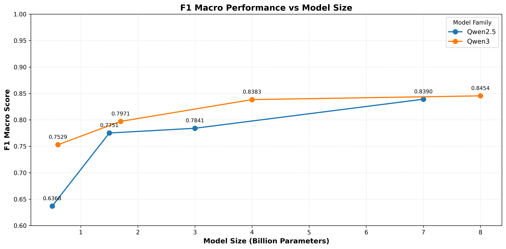

<!-- # Divide and Conquer: A Mixture-of-LoRA-Experts Approach for Efficient Hallucination Detection in Vietnamese LLMs -->

# Counterfactual Explanations for Vietnamese Hallucination Detection: Minimal Faithfulness Repairs with Security-Aware Robustness

## 📋 Overview

This repository contains the implementation and evaluation of hallucination detection models for Vietnamese Large Language Models (LLMs). The project focuses on identifying three types of hallucinations: **no hallucination**, **intrinsic hallucination**, and **extrinsic hallucination** in Vietnamese text generation.

## 🎯 Problem Statement

Hallucinations in LLMs pose significant challenges for real-world applications. This work addresses:
- **Intrinsic Hallucination**: Outputs that contradict the provided context
- **Extrinsic Hallucination**: Outputs that cannot be verified from the given context
- **No Hallucination**: Factually correct and contextually grounded outputs

## 📊 Dataset

We use the **UIT-ViHallu** dataset for training and evaluation:
- **Training set**: Used for fine-tuning models
- **Validation set**: Used for hyperparameter tuning
- **Test set**: 2,000 samples for final evaluation
- **Classes**: 3 categories (no, intrinsic, extrinsic)

## Module A — Hallucination Detector
| Models | Accuracy | F1 Macro | F1 Weighted | Precision | Recall | AUC |
|--------|----------|----------|-------------|-----------|--------|-----|
| Qwen3-8B | 0.8455 | 0.8454 | 0.8457 | 0.8462 | 0.8455 | 0.9377 |
| Qwen2.5-7B | 0.8390 | 0.8390 | 0.8392 | 0.8406 | 0.8390 | 0.8570 |
| Qwen3-4B | 0.8385 | 0.8383 | 0.8387 | 0.8393 | 0.8385 | 0.9410 |
| Qwen3-1.7B | 0.7960 | 0.7971 | 0.7969 | 0.8010 | 0.7960 | 0.9268 |
| Qwen2.5-3B | 0.7825 | 0.7841 | 0.7836 | 0.7856 | 0.7825 | 0.9046 |
| Qwen2.5-1.5B | 0.7750 | 0.7751 | 0.7746 | 0.7744 | 0.7750 | 0.9066 |
| Qwen3-0.6B | 0.7535 | 0.7529 | 0.7526 | 0.7526 | 0.7535 | 0.8895 |
| Qwen2.5-0.5B | 0.6340 | 0.6368 | 0.6363 | 0.6415 | 0.6340 | 0.8005 |

### 📈 Model Performance Analysis

**Figure 1: Comprehensive Model Comparison**

*Comparison of all evaluation metrics (Accuracy, F1 Macro, F1 Weighted, Precision, Recall, AUC) across different model sizes. Larger models consistently achieve better performance across all metrics.*

**Figure 2: Overall Performance Trend**

*F1 Macro score progression across all Qwen models as model size increases. Shows a clear positive correlation between model parameters and detection accuracy, with diminishing returns beyond 4B parameters.*

**Figure 3: Family Comparison**

*Comparison between Qwen2.5 and Qwen3 model families. Qwen3 models generally outperform their Qwen2.5 counterparts at similar parameter counts, suggesting architectural improvements in the newer generation.*

### 🔍 Key Findings

- **Best Performance**: Qwen3-8B achieves the highest accuracy of **84.55%** with F1 Macro of **0.8454**
- **Efficiency-Performance Trade-off**: Qwen3-4B offers excellent performance (83.85% accuracy) with significantly fewer parameters
- **Scaling Benefits**: Clear performance improvements with model size, especially from 0.5B to 4B parameters
- **Architecture Matters**: Qwen3 models consistently outperform Qwen2.5 at comparable sizes

## 🚀 Quick Start

### Installation

```bash
# Clone the repository
git clone https://github.com/yourusername/UIT-ViHallu.git
cd UIT-ViHallu

# Install dependencies
pip install -r requirements.txt
```

### Training

```bash
# Train a hallucination detection model
python scripts/qwen.py
```

## 📁 Project Structure

```
UIT-ViHallu/
├── data/                      # Dataset files
│   ├── vihallu_train.csv
│   ├── vihallu_dev.csv
│   └── vihallu_test.csv
├── models/                    # Trained models and predictions
│   ├── Qwen_Qwen2.5_0.5B/
│   ├── Qwen_Qwen3_8B/
│   └── ...
├── scripts/                   # Training and evaluation scripts
│   ├── qwen.py
│   └── load_and_inference.py
├── notebooks/                 # Jupyter notebooks for analysis
│   └── evaluate_models.ipynb
├── results/                   # Evaluation results and figures
│   ├── model_comparison.csv
│   ├── model_comparison.png
│   └── f1_vs_model_size.png
└── README.md
```

## 📝 Citation

If you use this work in your research, please cite:

```bibtex
@article{vihallu2026,
  title={Counterfactual Explanations for Vietnamese Hallucination Detection: Minimal Faithfulness Repairs with Security-Aware Robustness},
  author={Your Name},
  journal={arXiv preprint},
  year={2026}
}
```

## 📄 License

This project is licensed under the MIT License - see the LICENSE file for details.

## 🤝 Contributing

Contributions are welcome! Please feel free to submit a Pull Request.

## 📧 Contact

For questions or collaborations, please contact: [your.email@example.com]

---

**Last Updated**: February 2026
